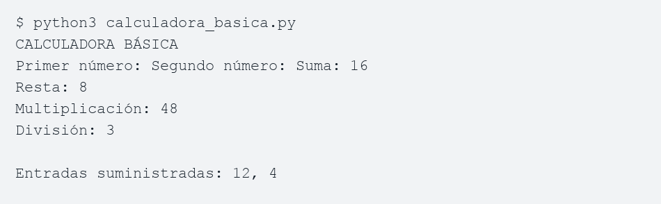

# Calculadora básica

Programa educativo en Python 3 que recibe dos números y muestra su suma,
resta, multiplicación y división. No utiliza bibliotecas externas.

## Ejecución

Desde la carpeta del proyecto:

```bash
python3 calculadora_basica.py
```

En Windows también puede usarse `py calculadora_basica.py`.

## Funcionamiento

`input()` recoge los datos y `float()` permite números decimales.
Las operaciones usan `+`, `-`, `*` y `/`. Una comprobación evita dividir
entre cero y `try/except` informa cuando una entrada no es numérica.

## Ejemplo

Con 12 y 4: suma 16, resta 8, multiplicación 48 y división 3.

## Evidencia de ejecución

Imagen de la transcripción de una ejecución real (no captura del escritorio):



