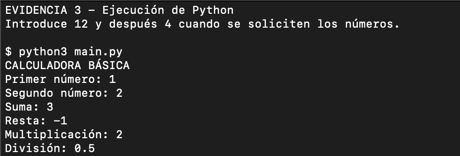

# Calculadora básica

Programa educativo en Python 3 que recibe dos números y muestra su suma,
resta, multiplicación y división. No utiliza bibliotecas externas.

## Ejecución

Desde la carpeta del proyecto:

```bash
python3 main.py
```

En Windows también puede usarse `py main.py`.

## Archivos del proyecto

- `main.py`: programa principal de la calculadora.
- `calculadora_basica.py`: conserva el nombre solicitado en la consigna; realiza las mismas operaciones.
- `.gitignore`: excluye cachés, entornos virtuales y configuración local.
- `README.md`: instrucciones, pruebas y documentación.

También puede ejecutarse `python3 calculadora_basica.py`.

## Funcionamiento

`input()` recoge los datos y `float()` permite números decimales.
Las operaciones usan `+`, `-`, `*` y `/`. Una comprobación evita dividir
entre cero y `try/except` informa cuando una entrada no es numérica.

## Ejemplo

Con 12 y 4: suma 16, resta 8, multiplicación 48 y división 3.

## Evidencia de ejecución

Captura real del programa en Terminal, con entradas 1 y 2:



## Pruebas y límites

- 1 y 2 (captura): suma 3, resta -1, multiplicación 2 y división 0.5.

- 12 y 4: resultados 16, 8, 48 y 3.
- 5 y 0: suma 5, resta 5, producto 0 y aviso de división no definida.
- -2.5 y 2: resultados -0.5, -4.5, -5 y -1.25.
- Una entrada como `hola` muestra un aviso y termina sin traceback.

Usar punto decimal. Se esperan números finitos de magnitud habitual.
El programa realiza una sola consulta por ejecución; no incluye menú.

## Colaboración

Crear una rama, describir los cambios, comprobar los casos anteriores
y proponer un Pull Request hacia `main`.
